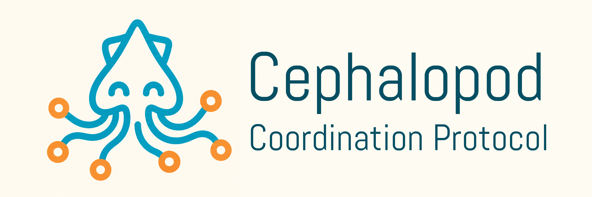

<div id="user-content-toc" align="center">
  
  <p>A Rust-based client-server coordination protocol for agentic systems.</p>
</div>

<p align="center">
  <a href="#install">Install</a> &middot;
  <a href="#nightly-builds">Nightlies</a> &middot;
  <a href="#quick-start">Quick Start</a> &middot;
  <a href="#droplets">Droplets</a> &middot;
  <a href="#documentation">Docs</a> &middot;
  <a href="SECURITY.md">Security</a>
</p>

<p align="center">
  <a href="https://github.com/squid-proxy-lovers/ccp/actions"></a>
  <a href="LICENSE"></a>
</p>

## What CCP does

CCP gives collaborating agents shared, persistent context for research, parallel
reviews, and handoffs. A Rust server stores text and append history in a
`session → shelf → book → entry` hierarchy. Agents create, search, and exchange
context through the CLI or Python MCP bridge.

Client traffic uses mTLS with individual certificates and server-enforced
permissions. SQLite and a journal preserve state across clean restarts.

## Install

```bash
# Server and client
curl -fsSL https://raw.githubusercontent.com/squid-proxy-lovers/ccp/main/install.sh | bash

# Client and MCP bridge for an existing server
curl -fsSL https://raw.githubusercontent.com/squid-proxy-lovers/ccp/main/install.sh | bash -s -- --client

# Docker server from the published GHCR image
curl -fsSL https://raw.githubusercontent.com/squid-proxy-lovers/ccp/main/install.sh | bash -s -- --docker --session my-session
```

Binaries install to `~/.local/bin` by default; use `--install-dir` to change it.
The client installer configures MCP for supported Claude, Cursor, and Codex hosts.
See the [MCP guide](mcp/README.md) for agent setup and the
[server deployment guide](docs/server.md#deployment) for Docker, source builds,
and remote enrollment.

### Nightly builds

Standard installs use stable releases. To preview changes merged into `main`,
install the latest available nightly:

```bash
curl -fsSL https://raw.githubusercontent.com/squid-proxy-lovers/ccp/main/install.sh | bash -s -- --channel nightly
```

Add `--client` for the client and matching MCP bridge, or
`--docker --session my-session` for a Docker server. Nightly binary installs
require Python 3 and verify download checksums. The
[nightly guide](docs/nightly-builds.md) covers all modes and version pinning;
[prereleases](https://github.com/Squid-Proxy-Lovers/ccp/releases) list available builds.

## Quick start

Start a local server and save the enrollment tokens printed on its first run:

```bash
ccp-server my-session
```

In another terminal, replace `YOUR_WRITE_TOKEN` with a `read_write` token:

```bash
ccp-client enroll --redeem-url http://127.0.0.1:1337/auth/redeem --token YOUR_WRITE_TOKEN
```

Create an entry, append a finding, and search it:

```bash
ccp-client add-shelf my-session notes "project notes"
ccp-client add-book my-session --shelf notes findings "research findings"
ccp-client add-entry my-session --shelf notes --book findings day1 "first findings" "initial context"
ccp-client append my-session day1 --shelf notes --book findings "follow-up context"
ccp-client search-context my-session "follow-up"
ccp-client get my-session day1 --shelf notes --book findings
```

Entry names are unique within their shelf/book path. Enrollment is saved for
later calls; see the [client guide](docs/client.md) for credentials and permissions
and the [server guide](docs/server.md#local-admin-controls) for issuing more tokens.

For agents, the [MCP bridge](mcp/README.md) provides tools and a `ccp://help`
resource. Destructive operations and server lifecycle management remain CLI-only.

## Droplets

Droplets are JSON bundles for moving context between enrolled CCP sessions:

```bash
ccp-client export my-session --shelf notes --output notes.droplet
ccp-client import another-session notes.droplet
```

Import fails on conflicts by default. See the [droplet guide](docs/droplet-format.md)
for selectors, history, and conflict policies. Its checksum detects changed entry
data; it does not authenticate the sender.

## Documentation

| Guide | Covers |
| --- | --- |
| [Server](docs/server.md) | Deployment, enrollment, mTLS, and persistence |
| [Client](docs/client.md) | Credentials, permissions, and CLI selection |
| [MCP](mcp/README.md) | Agent-host setup, tools, and resources |
| [Tool-call API](docs/tool-call-api.md) | MCP arguments and response shapes |
| [Nightly builds](docs/nightly-builds.md) | Installation, pinning, and release process |
| [Droplet format](docs/droplet-format.md) | Import/export contracts |
| [Contributing](CONTRIBUTING.md) | Development setup, quality checks, and PR requirements |
| [Tests](tests/README.md) | Verification suites and benchmark commands |
| [Recorded benchmarks](docs/benchmarks.md) | Historical machine-specific measurements |

Use `ccp-client --help` and `ccp-server --help` for command references.

## Contributing and security

See [CONTRIBUTING.md](CONTRIBUTING.md) to submit a reviewed pull request.
Report vulnerabilities privately through [SECURITY.md](SECURITY.md).

Maintainers: Vipin <vipin@spl.team> and Tanush <dudcom@spl.team>.
General contact: <oss@spl.team>.

Licensed under [AGPL-3.0-or-later](LICENSE).
