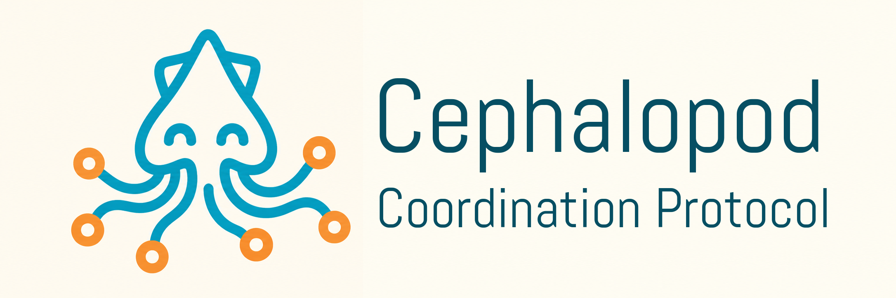

<div id="user-content-toc" align="center">
  
  <p>Persistent shared context for collaborating agents.</p>
</div>

<p align="center">
  <a href="#quick-start">Quick start</a> &middot;
  <a href="#install">Install</a> &middot;
  <a href="#mcp-setup">MCP setup</a> &middot;
  <a href="docs/README.md">Docs</a> &middot;
  <a href="CHANGELOG.md">Changelog</a> &middot;
  <a href="SECURITY.md">Security</a>
</p>

<p align="center">
  <a href="https://github.com/squid-proxy-lovers/ccp/actions"></a>
  <a href="LICENSE"></a>
</p>

CCP (Cephalopod Coordination Protocol) gives teams running collaborating agents
persistent, shared context for research, reviews and handoffs. A Rust server
stores that context in scoped workspaces; people manage access in a browser,
and agents read and write through the CLI or Python MCP bridge.

## Quick start

After [installing](#install), start a workspace instance:

```bash
ccp-server up --data-dir ./ccp-data
```

1. Open the setup link printed by the server. HTTPS defaults to
   `https://localhost:8443`; client mTLS uses `127.0.0.1:8444`.
2. Verify the browser certificate's SHA-256 against **Server leaf SHA-256** in
   the startup output, or install the independently verified public instance CA.
   See [browser trust](docs/workspace-foundation.md#browser-certificate-trust).
3. Name your workspace and save the one-time owner and instance admin keys.
   Sign in at `/admin` with the appropriate key.
4. In **Clients & access**, issue an enrollment link and share it with the
   intended client. On that machine, install the client and run:

   ```bash
   ccp enroll
   ```

   Paste the link at the hidden prompt. The client checks the link's CA pin,
   server name and instance identity before sending enrollment secrets. Save the
   profile path it prints, then [configure MCP](#mcp-setup).

The installer provides `ccp` as an alias when that name is available. Use
`ccp-client enroll` if another program owns it. Enrollment links carry access
secrets; the hidden prompt keeps them out of shell history.

Restart with the same data directory to keep the instance identity and contents.
For remote access, choose the DNS names and listener addresses before first boot;
see [server setup](docs/workspace-foundation.md#start-an-instance-in-one-command).

## Install

### macOS and Linux

```bash
# Server and client
curl -fsSL https://raw.githubusercontent.com/squid-proxy-lovers/ccp/v0.2.0/install.sh | bash

# Client and Python MCP bridge for an existing server
curl -fsSL https://raw.githubusercontent.com/squid-proxy-lovers/ccp/v0.2.0/install.sh | bash -s -- --client
```

Binaries install to `~/.local/bin`; `--install-dir` chooses another directory.
The client mode needs Python 3.10+ and configures the native MCP bridge for
existing supported hosts. Workspace MCP needs the separate configuration below.
Stable downloads select the latest stable release. For preview builds and exact
nightly pins, see [nightly builds](docs/nightly-builds.md).

### Windows client

On x86_64 Windows, use PowerShell 5.1+, Python 3.10+ (`python` on PATH), and a
recent GitHub CLI with attestation verification:

```powershell
irm https://raw.githubusercontent.com/squid-proxy-lovers/ccp/v0.2.0/install.ps1 | iex
```

The bootstrap is pinned to the v0.2.0 tag, signed and immutable by project policy.
It verifies installed release assets against an authenticated manifest, installs
under `%LOCALAPPDATA%\ccp\bin`, updates the user PATH and configures MCP with
backups. Re-run it to update. The server is not supported on Windows. See the
[Windows guide](docs/client.md#windows-installation) for options and trust details.

### Docker server

```bash
docker run --name ccp -p 127.0.0.1:8443:8443 -p 127.0.0.1:8444:8444 \
  -v ccp-data:/var/lib/ccp/server ghcr.io/squid-proxy-lovers/ccp:latest
```

For an exact v0.2.0 pin, use `ghcr.io/squid-proxy-lovers/ccp:2dd14e4f7966f93791485681269b4b8c386c5475`.

The default command starts the browser setup flow. Keep the volume and read the
setup link in the container log. Stable releases update `:latest` and a full
commit-SHA tag. Release candidates use their own tag, such as `:v0.2.0-rc.2`, and
leave `:latest` unchanged. See
[Docker and remote names](docs/workspace-foundation.md#docker).

### Build from source

Requires Rust 1.89+, Node.js 24 and npm for the embedded panel:

```bash
git clone --branch v0.2.0 https://github.com/squid-proxy-lovers/ccp.git
cd ccp
npm ci --prefix crates/server/web --ignore-scripts
cargo build --workspace --release --locked
./target/release/server up --data-dir ./ccp-data
```

Rustup selects the pinned development compiler. Cargo names the binaries
`server` and `client`; installed binaries are `ccp-server` and `ccp-client`.
Installed servers embed the panel and do not need Node.js. See
[contributing](CONTRIBUTING.md) for Python setup and required checks.

## Core concepts

| Concept | Purpose |
| --- | --- |
| Workspace | A scoped context store with its own access, content and guidance. |
| Owner | Manages the workspace, its admins and ownership transfer. |
| Admin | Manages content, client access, guidance and retention within its workspace. Archiving and deleting the workspace are reserved for the owner and instance admins. |
| Instance admin | Creates workspaces, appoints initial owners, archives or deletes workspaces and publishes global guidance. It can read workspace content but cannot admit clients or manage a workspace's team. |
| Client and grant | A registered client authenticates with mTLS. Explicit grants control its access to each workspace. |
| Shelf, book, entry | Shelves contain books; books contain text entries with revisions and history. Archives support recovery; permanent deletion requires confirmation. |
| Guidance | Global and workspace instruction boards published by administrators and delivered alongside MCP results. Guidance cannot grant permissions. |

The [admin panel](docs/workspace-browser-session.md#use-the-desktop-panel) at
`/admin` provides Overview, Context, Clients & access, Guidance, Reported work,
Settings and instance Workspaces views. It includes activity counts, content
editing and history, invitations, recovery, retention and deletion controls,
with light, dark and system appearance options.

## MCP setup

Use the workspace entry point **`ccp-workspace-mcp`** with matching 0.2.0 client
and MCP builds. The native **`ccp-mcp-server`** remains available for native
sessions; installer-created native host entries do not select workspace profiles.

Create a private `workspace-mcp.json`, replacing the profile path with the one
printed by enrollment:

```json
{"format":1,"profiles":{"team":"/absolute/path/to/enrolled-profile"}}
```

On Unix, run `chmod 600 workspace-mcp.json`. Use absolute paths throughout.
The macOS/Linux installer places the entry point at
`~/.ccp-mcp/venv/bin/ccp-workspace-mcp`. Expand `~` to your home directory's
absolute path in the host configuration.

For Claude's `~/.claude.json` or Cursor's `~/.cursor/mcp.json`, add this server
entry to the existing configuration:

```json
{
  "mcpServers": {
    "ccp-workspace": {
      "command": "/absolute/path/to/ccp-workspace-mcp",
      "env": {
        "CCP_WORKSPACE_CONFIG": "/absolute/path/to/workspace-mcp.json",
        "CCP_CLIENT_BIN": "/absolute/path/to/ccp-client"
      }
    }
  }
}
```

For Codex, add to `~/.codex/config.toml`:

```toml
[mcp_servers.ccp-workspace]
command = "/absolute/path/to/ccp-workspace-mcp"

[mcp_servers.ccp-workspace.env]
CCP_WORKSPACE_CONFIG = "/absolute/path/to/workspace-mcp.json"
CCP_CLIENT_BIN = "/absolute/path/to/ccp-client"
```

Restart the host after configuration. The [workspace MCP guide](docs/workspace-mcp.md)
covers profile aliases, explicit workspace selections, content tools, guarded
write retries, guidance and status messages. Enrollment and administration remain
outside this bridge. See the [native MCP guide](mcp/README.md) for native tools.

## Upgrading from 0.1.x

Back up the complete data directory after a clean shutdown and keep its matching
binary. Native mode retains wire protocol version 1 and its session-based CLI.
Workspace mode uses schema 27 and a separate HTTPS/mTLS interface; it does not
adopt native contents in place.

To move a complete native schema-2 instance, stop it and follow the
[offline conversion guide](docs/native-conversion.md): `ccp-server legacy-inspect`
checks the source and `ccp-server legacy-convert` creates a fresh instance at a new
destination. Source files remain intact. Provision its new TLS identity and
**enroll every client again**; old native tokens and certificates grant no access.
Unreleased HTTP schemas 3/4 and mixed databases cannot be converted.

See the [0.2.0 changelog](CHANGELOG.md#020---2026-11-12) for changes and upgrade limits.

## Release verification and security

[Release assets](https://github.com/Squid-Proxy-Lovers/ccp/releases/tag/v0.2.0)
include `SHA256SUMS`. Check downloaded bytes against it; checksums alone do not
authenticate the publisher. With the downloaded manifest and provenance bundle,
GitHub CLI can verify the manifest's attestation:

```bash
gh attestation verify ccp-release.json --bundle ccp-provenance.json \
  --repo Squid-Proxy-Lovers/ccp
```

For the full workflow identity, source commit and artifact size/hash policy,
follow [release bundle verification](docs/client-release-bundles.md). The
[managed client](docs/managed-client.md) and Windows installer enforce that policy.
The fetched bootstrap script itself is trusted before its verification runs.
Report vulnerabilities privately through [SECURITY.md](SECURITY.md).

## Documentation

Start at the [documentation index](docs/README.md), or choose a task:

- [Workspace client](docs/workspace-client.md) and [workspace selection](docs/workspace-selection.md)
- [Owner administration](docs/workspace-owner-administration.md) and [local key recovery](docs/local-workspace-administration.md)
- [Native server](docs/server.md), [native client](docs/client.md) and [droplet exchange](docs/droplet-format.md)
- [Collaboration examples](docs/use-cases.md), [tests](tests/README.md) and [historical benchmarks](docs/benchmarks.md)
- [Contributing](CONTRIBUTING.md) and [archived README map](docs/archive-notes.md)

Some detailed workspace guides retain development-phase notes; the released
entry points above are available in 0.2.0. Use `ccp-client --help` and
`ccp-server --help` for command references.

Maintainers: Vipin <vipin@spl.team> and Tanush <dudcom@spl.team>.
General contact: <oss@spl.team>. Licensed under [AGPL-3.0-or-later](LICENSE).
